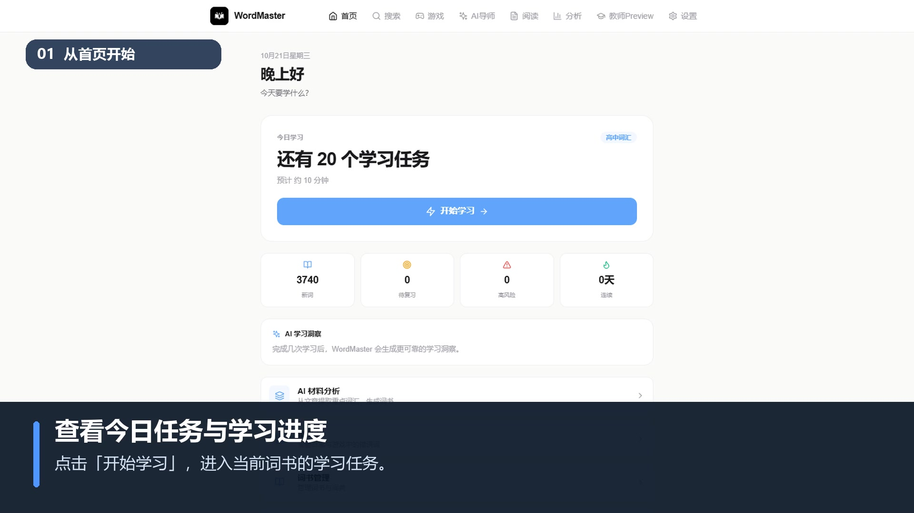
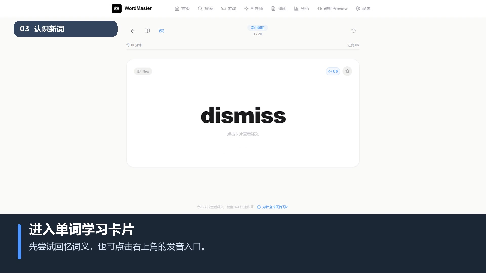
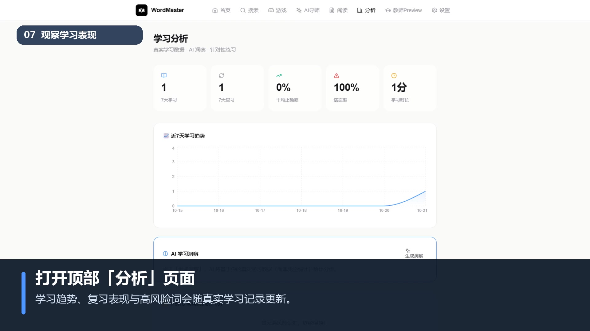
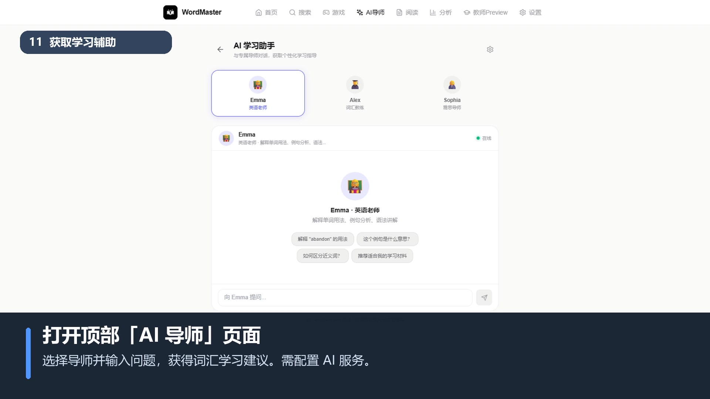

# WordMaster AI 📚

**AI 驱动的自适应词汇学习与教学平台** — 让 AI 决定学什么，让 FSRS 决定什么时候复习。

WordMaster 是一款面向英语学习者与教学场景的 Windows 桌面应用。它将词书学习、FSRS 自适应复习、学习数据分析、AI 材料生成与个性化辅导整合在同一条学习路径中；学习数据默认保存在本地，未配置 AI 服务时核心学习功能仍可使用。

> 本仓库为私有项目，采用专有软件许可，保留所有权利。

---

## 🖼 产品界面

| 今日学习任务 | 单词学习卡片 |
|:---:|:---:|
|  |  |

| 学习分析 | AI 学习助手 |
|:---:|:---:|
|  |  |

截图来自项目产品展示视频，展示首页任务、词汇学习、学习表现分析与 AI 导师等核心流程。

---

## ✨ 核心功能

| 模块 | 功能 |
|------|------|
| 📊 **Dashboard（首页）** | 今日任务、连续天数、掌握进度、最近学习记录、30 天热力图 |
| 📖 **单词学习** | 卡片翻转、英美双音、例句、四级反馈（忘记/困难/一般/简单）+ 键盘 1-4 |
| 🧠 **FSRS 自适应复习** | difficulty/stability/retrievability 状态，可解释的「为什么今天复习」 |
| 📄 **AI 材料引擎** | 从 TXT/Markdown/文本提取重点词汇，AI 分析 + 确认 → 一键生成词书 |
| 🤖 **AI 学习分析** | 错因诊断、易混词辨析、针对性练习生成、真实统计 + AI 洞察 |
| 📰 **AI 阅读** | 生成阅读文章 + 点词加入生词（记录来源语境，复习时回看） |
| 🔍 **单词搜索** | 英文/中文模糊搜索，学习词与词典词双路检索 |
| 📚 **词书管理** | 内置 5 本词书，支持 MDX/文本/AI 材料导入 |
| 🎓 **教师端** | 班级学习情况、共性薄弱词、AI 教学总结（Local Classroom Demo） |
| 📈 **学习分析** | 7 天趋势、熟练度分布、FSRS 高风险词、易混词辨析 |
| 🎨 **主题系统** | 6 套官方主题 + 自定义 RGB，暗色模式，localStorage 持久化 |

---

## 🏗 技术架构

```
React 18 (Vite) 前端
        ↓
PyWebView 桌面窗口（Windows / Edge WebView2）
        ↓
FastAPI 后端（uvicorn）
        ↓
Routers（words / stats / ai / books / dictionary / search / audio / games / media）
        ↓
Services（core / ai_service / audio_service / config_manager）
        ↓
SQLite（SQLAlchemy ORM）
```

| 层级 | 技术 |
|------|------|
| 前端 | React 18 + Vite + Tailwind CSS + Recharts + React Router 6 |
| 桌面壳 | PyWebView（原生 Windows 窗口，无地址栏） |
| 后端 | Python FastAPI + SQLAlchemy |
| 数据库 | SQLite（本地 `wordmaster.db`） |
| AI | DeepSeek API（`deepseek-chat` 模型） |
| 打包 | PyInstaller |

---

## 🤖 AI 能力

WordMaster 的 AI 功能使用 **DeepSeek API**（外部大模型服务）。

- API Key 通过应用内「设置 → AI 服务」配置，存储于 **Windows 凭据管理器（keyring）**，不写入源码、不记录日志、不回传前端。
- 未配置 API Key 时，所有基础学习功能仍可正常使用。

---

## 💾 本地数据与隐私

- 学习记录、词书、进度、音频缓存均存储在本地。
- 数据目录：`%APPDATA%\WordMaster\`。
- 当前版本不主动上传或收集用户个人信息。

---

## 🔁 复习机制（FSRS 自适应）

单词按 **FSRS（Free Spaced Repetition Scheduler）** 自适应安排复习，而非固定间隔：

- 每个词维护 `difficulty`（难度）、`stability`（稳定度，天）、`retrievability`（保持率）。
- 学习时选择四级反馈：**忘记 / 困难 / 一般 / 简单**，FSRS 据此计算下次复习时间。
- 点击「为什么今天复习」查看预计保持率、遗忘风险与下次复习时间。

算法实现：`server/srs/engine.py`（封装 MIT 许可的 `fsrs` 库，Open Spaced Repetition）。
旧的艾宾浩斯固定间隔已废弃，仅作兼容保留。

---

## 🚀 开发环境

### 1. 安装后端依赖

```bash
pip install -r requirements.txt
```

### 2. 构建前端

```bash
cd web
npm install
npm run build
```

### 3. 启动

**桌面模式**（PyWebView 窗口，自动启动后端）：

```bash
python main.py
```

**仅后端**（开发调试，访问 http://localhost:8000/docs 查看 API）：

```bash
cd server
python app.py
```

---

## 📦 打包

```bash
# 1. 构建前端
cd web && npm install && npm run build && cd ..

# 2. 打包主程序 EXE
pyinstaller wordmaster.spec --clean
# 输出：dist/WordMaster.exe

# 3. 打包安装程序（per-user，无需管理员权限）
cd installer
pyinstaller installer.spec --clean
# 输出：installer/dist/WordMaster_Setup.exe
```

用户无需安装 Python 或 Node.js。

---

## 📁 项目结构

```
WordMaster/
├── main.py                    # 桌面壳入口（PyWebView）
├── server/
│   ├── app.py                 # FastAPI 入口（中间件、路由注册、静态资源）
│   ├── core.py                # 共享领域逻辑（复习算法、词书映射、查询助手）
│   ├── db_init.py             # 数据库初始化与迁移
│   ├── models.py              # SQLAlchemy 数据模型
│   ├── database.py            # 数据库连接与会话
│   ├── schemas.py             # Pydantic 请求/响应模型
│   ├── ai_service.py          # DeepSeek API 集成
│   ├── audio_service.py       # Edge TTS 音频服务
│   ├── config_manager.py      # API Key 安全存储（keyring）
│   ├── seed.py                # 内置词库解析
│   ├── mdx_reader.py          # MDX 词典解析
│   ├── logging_config.py      # 日志配置
│   └── routers/               # 9 个路由模块（47 个 API 路由）
│       ├── words.py           # 学习队列 / 学习记录 / 收藏
│       ├── stats.py           # 仪表盘 / 统计
│       ├── ai.py              # AI 相关接口
│       ├── books.py           # 词书管理
│       ├── dictionary.py      # 词典搜索 / 导入
│       ├── search.py          # 搜索 / 收藏
│       ├── audio.py           # 音频
│       ├── games.py           # 游戏
│       └── media.py           # 插图
├── web/                       # React 前端
│   ├── src/
│   │   ├── pages/             # 13 个页面组件
│   │   ├── components/        # 通用组件
│   │   ├── theme/             # 主题系统
│   │   └── App.jsx            # 路由配置
│   └── package.json
├── tests/                     # 测试
├── scripts/                   # 项目统计脚本
├── data/vocabulary/           # 内置词库源文件
├── 内置词库请勿删除/           # 内置词库（打包用）
├── resources/                 # 图标、许可证
├── docs/PROJECT_FACTS.md      # 项目事实报告（数字唯一来源）
├── wordmaster.spec            # 主程序打包配置
├── requirements.txt
└── README.md
```

---

## 🔌 API 接口

后端共 **47 个 `/api/*` 路由 + 1 个 `/health` 探针**，按 9 个路由模块组织。完整交互式文档：启动后访问 http://localhost:8000/docs

| 模块 | 主要接口 |
|------|----------|
| 学习 | `/api/words/*`、`/api/study`、`/api/study/reset` |
| 统计 | `/api/dashboard`、`/api/stats`、`/api/stats/weekly`、`/api/stats/errors` |
| AI | `/api/ai/chat`、`/api/ai/generate-reading`、`/api/ai/explain`、`/api/ai/quiz`、`/api/ai/report` |
| 词书 | `/api/books`、`/api/books/{id}/activate`、`/api/books/{id}/progress` |
| 词典 | `/api/dictionary/search`、`/api/dictionary/import`、`/api/dictionary/word/{word}` |
| 搜索 | `/api/search`、`/api/search/all`、`/api/favorites` |
| 音频 | `/api/audio/{word}`、`/api/audio/voices` |

---

## 📄 许可证

**专有软件，保留所有权利。**

Copyright © 2026 JasonChen. All rights reserved.

WordMaster is a proprietary English vocabulary learning application independently developed by JasonChen.

This repository is intended for project presentation, documentation, release distribution, and issue tracking.

Unless explicitly authorized, the publication of this repository does not grant permission to reproduce, modify, redistribute, or commercially exploit the proprietary software or its source code.

WordMaster has obtained software copyright registration in China.

本项目为内部 Beta 测试版本。未经作者许可，禁止复制、修改、再分发或商业使用。

详见 `license_agreement.txt` 与安装程序中的《WordMaster 软件使用协议》。

作者：JasonChen ｜ 联系：cby080812b@outlook.com
