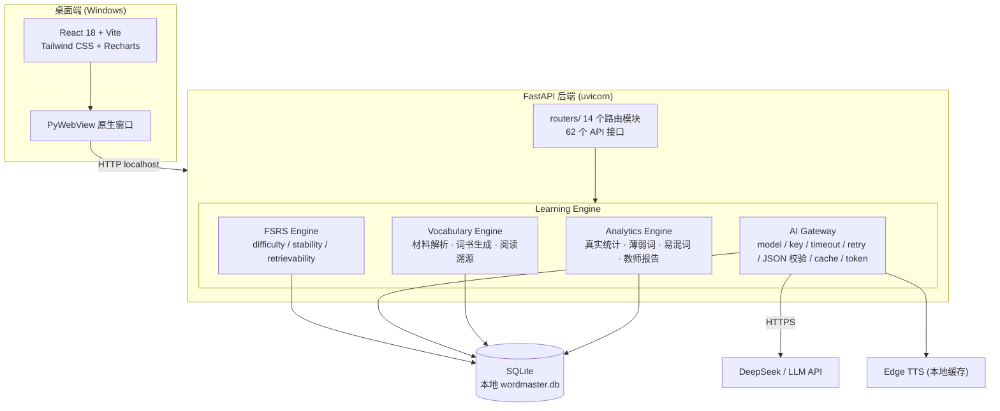

# 03 · 技术架构 (TECHNICAL ARCHITECTURE)

## 总览



## 分层说明

| 层 | 技术 | 职责 |
|---|---|---|
| 前端 | React 18 + Vite + Tailwind + Recharts | 13+ 页面，懒加载，AbortController 超时 |
| 桌面壳 | PyWebView | 原生 Windows 窗口，自动启动/停止后端 |
| 后端 | FastAPI + SQLAlchemy 2.x | 分层：routers / services / models / schemas |
| FSRS Engine | `server/srs/engine.py`（封装 MIT `fsrs` 库） | 四级反馈 → 自适应下次复习 + 可解释性 |
| AI Gateway | `server/ai/gateway.py` + `providers/` | 统一 model/key/timeout/retry/JSON 校验/日志/token |
| AI Services | `server/ai/services/` | material / analysis / exercise / example |
| 数据库 | SQLite（WAL + busy_timeout + 迁移备份） | 本地优先，19 张业务表 + schema_version 迁移追踪 |

## 数据库 Schema（核心表）

```
words / book_words / books / dictionary         — 词库与词书
word_memory_state                              — FSRS 记忆状态（核心）
study_records / daily_stats                    — 学习行为记录
word_ai_explanations / ai_content_cache        — AI 内容缓存（分级）
source_documents / source_words                — 阅读溯源
confusion_sets                                 — 易混词系统
courses / students / student_word_stats        — 教师端（演示数据标注）
schema_version                                 — 迁移追踪
```

## 关键设计决策

1. **FSRS 单一事实来源**：`word_memory_state.due` 是下次复习的唯一依据；旧的 Ebbinghaus 字段仅作兼容。
2. **AI 挂掉 ≠ 软件不能用**：所有 AI 入口带 timeout + 降级；基础背词完全离线可用。
3. **结构化 AI 输出**：pydantic schema 校验 + retry + repair + fallback，杜绝“假数据”进入数据库。
4. **Local First**：数据全本地；AI 只发完成任务所需的最小内容。
5. **迁移安全**：迁移前自动备份 `wordmaster.db`，迁移失败回滚。

## 打包

- 主程序：PyInstaller → `dist/WordMaster.exe`（含预初始化种子库，首启快）。
- 安装器：per-user，无需管理员权限。
